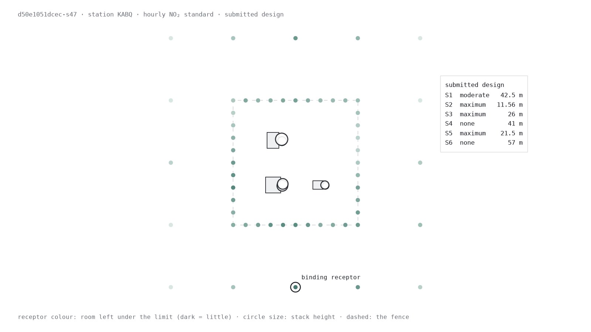

# PermitForge

Choose emissions controls and stack heights for a synthetic industrial plant,
using real NOAA weather and EPA dispersion models. An OpenEnv environment:
cut annualized cost while meeting every air-quality standard.

[Space](https://huggingface.co/spaces/Attoloop/PermitForge) ·
[Dataset](https://huggingface.co/datasets/Attoloop/PermitForge) ·
[Trained model](https://huggingface.co/Attoloop/PermitForge-Qwen3.8-27B-GRPO) ·
[Eval card](results/eval-v2.json) · OpenEnv 0.7.0 · Apache-2.0



## The task

Choose a compatible control and one menu height for every source. Meet each NO2,
SO2 and PM2.5 standard at every receptor, including background concentrations,
across the task's weather years. Taller stacks and stronger controls cost more.
The draft uses maximum controls at GEP height.

| Tool | What it does |
|---|---|
| `get_scenario()` | Sources, controls, menus, standards, draft and remaining evaluations |
| `check_design(design)` | Validity and exact annualized cost; free and unlimited |
| `evaluate_design(design)` | Air-quality values, margins and binding receptors; 30 valid evaluations per episode |
| `submit_design(design)` | Ends the episode and grades once with full BPIP/AERMOD verification |

Reward is the feasible fraction of draft cost saved:
`(cost(draft) - cost(design)) / cost(draft)`. The unchanged draft, invalid,
infeasible and absent submissions score zero. USD/year saved is also reported.
A score of 1.0 means zero annualized cost, unreachable because the uncontrolled
design fails an air-quality standard. No calibration or anchors are needed.

All **360 tasks are admitted: 230 train and 130 eval**, separated by weather
station, with every draft verified feasible under ARM2. V2 uses ARM2 for all NO2
cases and discrete heights, so its feasible set differs from published v1.
Search and baselines are diagnostics, independent of admission and reward.
Reproduce the counts from the task records:

```sh
python3 envs/permit/openenv/space_root/report_evidence.py
```

## Results

Four models, 10 held-out eval tasks, 3 repeats each, 40 turns, 30 evaluations,
medium effort. Reward is the saved fraction; the interval is a station-clustered
bootstrap. Every episode was verified with the native models.

| Model | Mean saved fraction | 95% CI | Feasible | USD per episode |
|---|---:|---|---:|---:|
| GPT-6.1 Sol | 0.6065 | 0.5423 to 0.6768 | 30/30 | n/a (subscription) |
| GPT-5.6 Sol | 0.5858 | 0.5186 to 0.6634 | 30/30 | n/a (subscription) |
| Claude Opus 5.5 | 0.5755 | 0.5005 to 0.6602 | 30/30 | 1.71 |
| Claude Sonnet 5.5 | 0.5071 | 0.4239 to 0.6000 | 30/30 | 0.37 |

Model-free policies on the same tasks, with fast-field probes: draft 0.00,
cheapest-first greedy 0.33, v1 coordinate descent 0.40, random 30 evaluations
0.31 (best of 8 seeds 0.46), 60-second search 0.48. The same four models on a
10-task train cohort score 0.49 to 0.57 ([results/final-train.md](results/final-train.md)).

Full tables, per-task repeats and the transcript audit:
[results/final-eval.md](results/final-eval.md),
[results/variance-final.md](results/variance-final.md),
[results/reward-hacks.md](results/reward-hacks.md). Protocol: [eval/PROTOCOL.md](eval/PROTOCOL.md).
Every rollout is in the dataset.

**Training.** We trained Qwen3.8-27B with GRPO (LoRA, 30 steps, 6 rollouts per
step, one H200, $164 for the whole project) and evaluated base and trained model
on the same 10 held-out tasks with the same cloud harness. Base 0.439, trained
0.439: no change. The per-task table, curves, failures and cost are in
[train/cloud/RESULTS.md](train/cloud/RESULTS.md); the card is
[results/eval-v2-qwen.json](results/eval-v2-qwen.json). That harness differs
from the frontier one, so the two tables are not compared.

## Start here

| You want to… | Open |
|---|---|
| Try the playground | [The Space](https://huggingface.co/spaces/Attoloop/PermitForge), or `/web/` on a local server |
| Connect an agent | Client snippet below; MCP endpoint `/mcp` |
| Read the rules and reward | [CONTRACT.md](CONTRACT.md) |
| Understand physics, fidelity and search | [DESIGN.md](DESIGN.md) |
| Read the data contract | [docs/SCHEMAS.md](docs/SCHEMAS.md) |
| Trace inputs and licences | [SOURCES.md](SOURCES.md) |
| Get tasks, weather, rollouts and the training run | [The dataset](https://huggingface.co/datasets/Attoloop/PermitForge) |
| Train a model | [train/cloud/README.md](train/cloud/README.md) |
| Build the Space image | [Space card](envs/permit/openenv/space_root/README.md) |

## Connect an agent

Start the server below, then run this with `uv run python` from
`envs/permit/openenv`. It reads and validates the actual draft without calling a
model API. `space_root/smoke.py` exercises this snippet against a live server.

```python
from openenv.core.env_server.mcp_types import CallToolAction
from openenv.core.mcp_client import MCPToolClient
from permit_openenv.protocol import tool_result

with MCPToolClient("http://127.0.0.1:8012", message_timeout_s=1800).sync() as env:
    obs = env.reset(task_id="040cd27878ef-s47")  # or reset(split="train", index=0)
    print(obs.observation.metadata["instructions"])
    scenario = tool_result(env.step(CallToolAction(tool_name="get_scenario", arguments={})).observation)
    design = scenario["draft_design"]
    checked = env.step(CallToolAction(tool_name="check_design", arguments={"design": design}))
    print(tool_result(checked.observation))
```

Use the same `CallToolAction` shape for `evaluate_design` and `submit_design`,
with `arguments={"design": design}`. Keep the client connected during native
submission, which may take minutes.

## Run it locally

A checkout has the code and the task records but not the task data, weather
files or native binaries. Get the data from the dataset and build the binaries:

```sh
uvx --from 'huggingface-hub==1.33.0' hf download Attoloop/PermitForge --repo-type dataset \
  --include 'tasks/data/*' 'tasks/met/*' --local-dir envs/permit
sh envs/permit/core/native_build/build.sh  # needs podman
uv sync --directory envs/permit/openenv --python 3.12 --frozen
uv run --directory envs/permit/openenv uvicorn permit_openenv.server:app \
  --host 127.0.0.1 --port 8012 --workers 1 --ws-ping-timeout 1800
```

Binaries live in `envs/permit/core/native_build/bin/`, or wherever `PERMIT_MODELS_DIR`
points. The playground is at `/web/` and `/healthz` reports health and task counts.
Fields are cached on demand: an uncached task takes minutes to prepare.
`PERMIT_FIELDS_JOBS` sets preparation parallelism and `PERMIT_FIELDS_CACHE_GB`
caps idle storage. Submission always uses native verification. Use a local
server for heavy runs.

Smoke and test suites, from the repository root:

```sh
uv run --directory envs/permit/openenv python rollout.py --smoke \
  --task-id 040cd27878ef-s47 --output ../../../results/rollouts/smoke.json
uv run pytest -q
uv run --directory envs/permit/core pytest -q
uv run --directory envs/permit/openenv pytest -q
uv run python convert/v1_to_v2.py --out envs/permit/tasks --check
```

Tests that need inputs a checkout does not have (the v1 source extraction, local
run folders, cached model weights) skip and say why. No model credentials are
needed for any command above.

Build and check the Space image:

```sh
podman build -f envs/permit/openenv/Dockerfile -t permitforge-space .
podman run --rm --name permitforge-space -p 127.0.0.1:7860:7860 permitforge-space
# In another terminal:
uv run --project envs/permit/openenv python envs/permit/openenv/space_root/smoke.py \
  --url http://127.0.0.1:7860 --output results/evidence/space-smoke.json
```

The image bakes two eval showcases; other tasks build fields on demand.
[The container smoke receipt](results/evidence/space-container-smoke.json) records
the endpoints and tool results of the published image.

## Layout

```text
README.md, DESIGN.md, CONTRACT.md, SOURCES.md   task, implementation, rules, provenance
docs/SCHEMAS.md                                public data contract
convert/                                      extraction, conversion and diagnostics
envs/permit/
  core/                                       verifier, evaluator, cache, cost, reward, search
  openenv/                                    OpenEnv server, tools, rollout harness, Space recipe
  tasks/                                      train/eval and legacy records; local task/met data
eval/                                         frontier evaluation harness, protocol, cards
train/cloud/                                  Qwen3.8-27B GRPO on HF Jobs, results and launch scripts
results/                                      boards, cards, variance, audit, measurement receipts
```

## Data and licence

Meteorology is NOAA ISD hourly observations and IGRA2 soundings, processed by
AERMET. EPA SCRAM supplies AERMOD and BPIP-PRIME. Facilities, emissions, controls,
costs, backgrounds and ozone are synthetic. Flat terrain, one control ladder per
source and a common stack-extension price within each facility limit coverage.
Station-disjoint tasks do not represent real industrial inventories.

[SOURCES.md](SOURCES.md) records acquisition URLs, hashes, build pins and
U.S. Government-work terms. Code is licensed under [Apache-2.0](LICENSE).
Use [CITATION.cff](CITATION.cff) to cite PermitForge.
